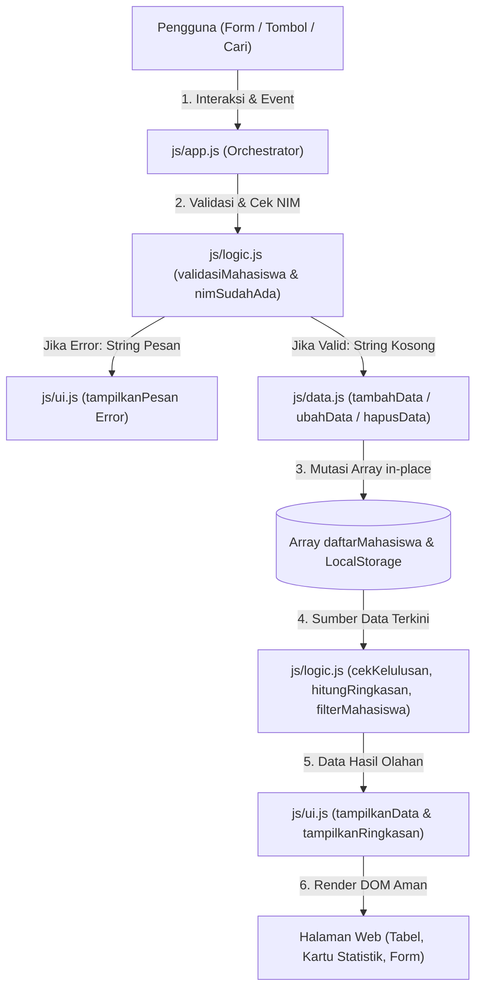

# Laporan Praktikum Pemrograman Visual
# Modul 09: Penerapan Prosedur, Fungsi, dan Modularisasi Program Visual
## Proyek: Aplikasi Data Mahasiswa Modular

---

## 1. Deskripsi Proyek, Teknologi, & Cara Menjalankan

### Deskripsi Singkat
**Aplikasi Data Mahasiswa Modular** adalah aplikasi web berbasis *Single Page Application* (SPA) sederhana untuk mengelola data mahasiswa (Nama, NIM, Nilai angka, dan Status Kelulusan). Aplikasi ini dirancang untuk mendemonstrasikan konsep **Modularisasi JavaScript (ES Modules)**, prinsip **Pemisahan Peran (*Separation of Concerns*)**, serta perbedaan mendasar antara **fungsi pengembali nilai (*function*)** dan **prosedur (*procedure*)**.

### Teknologi yang Digunakan
- **HTML5**: Struktur halaman semantik dan form input aksesibel.
- **CSS3**: Tata letak responsif (CSS Grid & Flexbox), *CSS Variables*, dan indikator fokus aksesibilitas.
- **JavaScript (ES2020+ Vanilla ES Modules)**: Modularitas murni tanpa dependensi eksternal, tanpa *framework*, dan tanpa *bundler*.
- **Web Storage API (LocalStorage)**: Penyimpanan data lokal di sisi peramban.

### Cara Menjalankan Aplikasi (Wajib Local Server)
> [!IMPORTANT]
> Aplikasi ini **tidak boleh** dibuka langsung melalui protokol berkas lokal (`file:///`) karena browser modern menerapkan aturan keamanan CORS yang memblokir pemuatan file JavaScript ES Modules lokal. Aplikasi wajib dijalankan melalui HTTP Server lokal.

**Langkah Menjalankan via VS Code Live Server:**
1. Buka folder proyek `aplikasi-mahasiswa-modular` di VS Code.
2. Pastikan ekstensi **Live Server** (oleh Ritwick Dey) sudah terpasang.
3. Klik kanan pada berkas `index.html`, lalu pilih **"Open with Live Server"** (atau tekan tombol *Go Live* di status bar kanan bawah).
4. Browser akan terbuka otomatis pada alamat `http://127.0.0.1:5500/index.html`.

*(Alternatif: Gunakan terminal dengan perintah `npx serve .` atau `python -m http.server 8000`).*

---

## 2. Struktur Folder & Tanggung Jawab Tiap Modul

### Pohon Struktur Berkas
```text
aplikasi-mahasiswa-modular/
|-- index.html          # Kerangka antarmuka HTML semantik
|-- README.md           # Laporan dokumentasi pengumpulan praktikum
|-- css/
|   `-- style.css       # Lembar gaya tampilan responsif & tema warna
|-- docs/
|   |-- PANDUAN_PENILAIAN_DAN_TANYA_JAWAB.md # Rubrik penilaian & bank soal
|   `-- screenshots/    # Tangkapan layar bukti pengujian di peramban
`-- js/
    |-- app.js          # Modul Orkestrator & Event Listener utama
    |-- data.js         # Modul Penyimpanan Data in-memory & LocalStorage
    |-- logic.js        # Modul Logika Bisnis & Validasi (Pure Functions)
    `-- ui.js           # Modul Tampilan Antarmuka & Manipulasi DOM
```

### Tabel Tanggung Jawab Modul
| Nama Modul | Tanggung Jawab Utama | Akses DOM (`document`) | Catatan Khusus |
|---|---|:---:|---|
| **`data.js`** | Mengelola array `daftarMahasiswa`, operasi CRUD in-place, dan sinkronisasi `localStorage`. | ❌ **DILARANG** | Bebas DOM murni. Referensi array `const` dipertahankan *in-place*. |
| **`logic.js`** | Berisi logika validasi, kelulusan, penyaringan pencarian, dan kalkulasi ringkasan statistik. | ❌ **DILARANG** | *Pure functions* murni (deterministik & tanpa efek samping). |
| **`ui.js`** | Merender tabel mahasiswa, kartu statistik, notifikasi status, dan pengaturan mode form. | ✅ **YA** | Menggunakan `.textContent` pada elemen `createElement` (aman XSS). |
| **`app.js`** | Penghubung utama, pengelola state mode edit, pembaca input, dan pemasang *event listener*. | ✅ **YA** (Event saja) | Berperan sebagai konduktor orkestrasi alur data. |

---

## 3. Diagram Alur Antarmodul (Data Flow)

### Diagram Alur Mermaid


### Diagram Alur Teks ASCII
```text
[ Pengguna ] 
      │ (submit form / klik edit / klik hapus / ketik cari)
      ▼
┌──────────────┐
│  js/app.js   │ ──(1. kirim data input)──> ┌──────────────┐
│ (Koordinator)│                            │ js/logic.js  │ ──> [Validasi & Cek NIM]
└──────┬───────┘ <──(2. respon validasi)──── └──────────────┘
       │
       │ (jika valid)
       ▼
┌──────────────┐                            ┌──────────────┐
│  js/data.js  │ ──(3. simpan in-place)───> │ LocalStorage │
└──────┬───────┘                            └──────────────┘
       │
       │ (4. perbarui UI)
       ▼
┌──────────────┐
│   js/ui.js   │ ──(5. render textContent)──> [ DOM / Browser ]
└──────────────┘
```

---

## 4. Penjelasan Fungsi Tiap Modul

Berikut rincian seluruh fungsi di setiap modul beserta parameter, nilai kembalian, dan klasifikasinya:

### A. Modul `js/data.js`
1. **`tambahData(mahasiswa)`**
   - **Parameter**: `mahasiswa` (Object: `{ nama, nim, nilai }`).
   - **Return**: Tidak me-return nilai (`void`).
   - **Klasifikasi**: **Prosedur** (melakukan aksi menambahkan data ke array dan menyimpannya ke `localStorage`).
2. **`hapusData(nim)`**
   - **Parameter**: `nim` (String/Number).
   - **Return**: `boolean` (`true` jika data ditemukan dan dihapus, `false` jika tidak ditemukan).
   - **Klasifikasi**: **Fungsi pengembali nilai** (menghapus data dan mengembalikan status keberhasilan).
3. **`ubahData(nimLama, dataBaru)`**
   - **Parameter**: `nimLama` (String), `dataBaru` (Object: `{ nama, nim, nilai }`).
   - **Return**: `boolean` (`true` jika berhasil diubah, `false` jika data tidak ditemukan).
   - **Klasifikasi**: **Fungsi pengembali nilai** (memperbarui objek mahasiswa dan mengembalikan status operasi).

### B. Modul `js/logic.js`
1. **`validasiMahasiswa(nama, nim, nilai, daftar = [], nimDiabaikan = null)`**
   - **Parameter**: `nama` (String), `nim` (String), `nilai` (String/Number), `daftar` (Array, opsional), `nimDiabaikan` (String, opsional).
   - **Return**: `string` (Pesan error `"Semua data wajib diisi."`, `"Nilai harus berupa angka 0 sampai 100."`, `"NIM sudah terdaftar."`, atau string kosong `""` jika valid).
   - **Klasifikasi**: **Fungsi pengembali nilai** (*pure function* murni validasi).
2. **`cekKelulusan(nilai)`**
   - **Parameter**: `nilai` (String/Number).
   - **Return**: `string` (`"Lulus"` jika nilai $\ge 60$, atau `"Belum Lulus"` jika $< 60$).
   - **Klasifikasi**: **Fungsi pengembali nilai** (*pure function* penentu kelulusan).
3. **`nimSudahAda(nim, daftar = [], nimDiabaikan = null)`**
   - **Parameter**: `nim` (String), `daftar` (Array), `nimDiabaikan` (String/null).
   - **Return**: `boolean` (`true` jika NIM sudah terdaftar pada mahasiswa lain, `false` jika belum).
   - **Klasifikasi**: **Fungsi pengembali nilai** (*pure function* pemeriksa keunikan NIM).
4. **`filterMahasiswa(daftar = [], kata = "")`**
   - **Parameter**: `daftar` (Array), `kata` (String).
   - **Return**: `Array<Object>` (Daftar mahasiswa baru hasil penyaringan nama atau NIM).
   - **Klasifikasi**: **Fungsi pengembali nilai** (*pure function* pencarian).
5. **`hitungRingkasan(daftar = [])`**
   - **Parameter**: `daftar` (Array).
   - **Return**: `Object` (`{ totalMahasiswa: number, totalLulus: number, totalBelumLulus: number }`).
   - **Klasifikasi**: **Fungsi pengembali nilai** (*pure function* kalkulasi statistik).

### C. Modul `js/ui.js`
1. **`tampilkanData(daftar = daftarMahasiswa)`**
   - **Parameter**: `daftar` (Array objek mahasiswa, default ke array data utama).
   - **Return**: Tidak me-return nilai (`void`).
   - **Klasifikasi**: **Prosedur** (melakukan aksi manipulasi DOM untuk merender baris tabel).
2. **`tampilkanRingkasan(daftar = daftarMahasiswa)`**
   - **Parameter**: `daftar` (Array objek mahasiswa).
   - **Return**: Tidak me-return nilai (`void`).
   - **Klasifikasi**: **Prosedur** (melakukan aksi manipulasi DOM untuk memperbarui teks kartu statistik).
3. **`bersihkanForm()`**
   - **Parameter**: Tidak ada.
   - **Return**: Tidak me-return nilai (`void`).
   - **Klasifikasi**: **Prosedur** (melakukan aksi mereset field input form dan memfokuskan kursor ke input Nama).
4. **`setModeEdit(aktif, mhs = null)`**
   - **Parameter**: `aktif` (boolean), `mhs` (Object mahasiswa yang diedit / null).
   - **Return**: Tidak me-return nilai (`void`).
   - **Klasifikasi**: **Prosedur** (melakukan aksi manipulasi tampilan form antara mode tambah dan mode edit).
5. **`tampilkanPesan(teks, tipe = "")`**
   - **Parameter**: `teks` (String pesan), `tipe` (String jenis styling: "sukses", "error", "info").
   - **Return**: Tidak me-return nilai (`void`).
   - **Klasifikasi**: **Prosedur** (melakukan aksi menampilkan teks feedback status ke elemen `#pesan`).

---

## 5. Tabel Hasil Pengujian (Skenario Wajib & Fitur Baru)

Pengujian dilakukan menggunakan lingkungan peramban sesungguhnya (*browser runtime* via CDP & Local HTTP Server):

| No | Skenario Pengujian | Input Pengujian | Hasil yang Diharapkan | Hasil Pengujian Aktual | Status |
|:---:|---|---|---|---|:---:|
| **1** | **Input lengkap, nilai 80 (Lulus)** | Nama: `"Ahmad Fauzi"`<br>NIM: `"2024001"`<br>Nilai: `80` | Status tabel: `"Lulus"`<br>Pesan: `"Data berhasil ditambahkan."` | Status: `"Lulus"`<br>Pesan: `"Data berhasil ditambahkan."` | **LULUS** |
| **2** | **Input lengkap, nilai 50 (Belum Lulus)** | Nama: `"Budi Darmawan"`<br>NIM: `"2024002"`<br>Nilai: `50` | Status tabel: `"Belum Lulus"`<br>Pesan: `"Data berhasil ditambahkan."` | Status: `"Belum Lulus"`<br>Pesan: `"Data berhasil ditambahkan."` | **LULUS** |
| **3** | **Nama atau NIM kosong** | Nama: `""`, NIM: `"2024003"`, Nilai: `75` | Muncul pesan error: `"Semua data wajib diisi."`, data ditolak | Pesan: `"Semua data wajib diisi."`, tabel tidak bertambah | **LULUS** |
| **4** | **Nilai di luar 0 - 100** | Nilai: `120`, lalu Nilai: `-5` | Muncul pesan error: `"Nilai harus berupa angka 0 sampai 100."` | Pesan: `"Nilai harus berupa angka 0 sampai 100."`, data ditolak | **LULUS** |
| **5** | **Klik tombol Hapus** | Klik tombol `"Hapus"` pada baris Budi Darmawan | Baris terhapus dari tabel,<br>Pesan: `"Data berhasil dihapus."` | Baris terhapus (sisa 1),<br>Pesan: `"Data berhasil dihapus."` | **LULUS** |
| **6** | **NIM Unik (Fitur Opsional 1)** | Masukkan NIM `"2024001"` yang sudah terdaftar | Muncul pesan error: `"NIM sudah terdaftar."`, data ditolak | Pesan: `"NIM sudah terdaftar."`, tabel tidak bertambah | **LULUS** |
| **7** | **Ringkasan Statistik (Fitur Opsional 2)** | Tambah mahasiswa (2 Lulus, 1 Belum Lulus) | Kartu terisi: Total = 3, Lulus = 2, Belum Lulus = 1 | Total: `3`, Lulus: `2`, Belum Lulus: `1` | **LULUS** |
| **8** | **Pencarian Real-Time (Fitur Opsional 3)** | Ketik kata kunci `"Dewi"` atau NIM `"2024004"` | Tabel memfilter baris yang cocok secara instan | Filter instan sesuai kata kunci, reset menampilkan semua data | **LULUS** |
| **9** | **Edit Data (Fitur Opsional 4)** | Klik Edit, ubah nilai dari 45 ke 75, klik Simpan | Nilai terbarui jadi 75, status jadi Lulus, tombol kembali normal | Data terbarui, status Lulus, tombol kembali ke mode tambah | **LULUS** |
| **10** | **LocalStorage (Fitur Opsional 5)** | Muat ulang peramban (*browser refresh*) | Seluruh data mahasiswa dan ringkasan tetap ada | Data 3 baris tetap utuh dan tersimpan di LocalStorage | **LULUS** |

```text
Audit Konsol Peramban: 0 Errors (NOL Galat)
```

---

## 6. Evaluasi Pemahaman Materi

Berikut adalah jawaban atas 7 pertanyaan evaluasi pemahaman praktikum:

1. **Perbedaan function yang mengembalikan nilai dan yang melakukan aksi (prosedur):**  
   Fungsi yang mengembalikan nilai (*fruitful function*) memproses masukan dan selalu menghasilkan suatu data luaran melalui kata kunci `return` untuk digunakan pada baris kode lain (contoh: `cekKelulusan` menghasilkan string status). Sebaliknya, prosedur (*procedure*) bertugas menjalankan sekumpulan instruksi atau perintah aksi tanpa mengembalikan nilai data apapun, seperti memanipulasi tampilan DOM atau mengosongkan formulir (contoh: `tampilkanData` dan `bersihkanForm`).

2. **Perbedaan parameter vs argumen:**  
   Parameter adalah variabel penampung yang didefinisikan pada bagian deklarasi fungsi untuk menerima nilai dari luar (misalnya variabel `nilai` pada definisi `function cekKelulusan(nilai)`). Sedangkan argumen adalah nilai konkret atau variabel nyata yang secara aktual dikirimkan ke dalam fungsi tersebut saat fungsi dipanggil untuk dieksekusi (misalnya angka `80` pada pemanggilan `cekKelulusan(80)`).

3. **Alasan fungsi `validasiMahasiswa()` diletakkan di `logic.js`:**  
   Fungsi `validasiMahasiswa()` ditempatkan di `logic.js` karena pemeriksaan kelengkapan dan rentang angka adalah aturan bisnis murni yang tidak boleh terikat langsung dengan elemen fisik antarmuka (DOM). Dengan memisahkannya ke `logic.js`, logika validasi menjadi fungsi murni (*pure function*) yang mudah diuji secara otomatis (*unit testable*) serta dapat digunakan ulang tanpa perlu bergantung pada struktur HTML.

4. **Fungsi kata kunci `export` dan `import` pada JavaScript ES Modules:**  
   Kata kunci `export` berfungsi untuk membuka akses variabel, fungsi, atau objek di suatu modul agar dapat digunakan oleh modul lain di luar berkas tersebut. Sebaliknya, kata kunci `import` digunakan oleh suatu modul untuk mengambil dan menggunakan fungsi atau variabel yang telah diekspor oleh modul lain tersebut sesuai kebutuhan.

5. **Keuntungan memisahkan data, logika, dan tampilan (*Separation of Concerns*):**  
   Pemisahan ini membuat arsitektur kode menjadi sangat rapi, mudah dibaca, dan mudah dirawat (*maintainable*), karena setiap berkas memiliki satu tanggung jawab spesifik yang terisolasi. Jika terjadi perubahan desain antarmuka, kita hanya perlu mengubah `ui.js` tanpa khawatir merusak logika kelulusan atau struktur data, begitupun sebaliknya saat logika bisnis diperbarui.

6. **Akibat jika path `import` salah:**  
   Jika penulisan path pada `import` salah (misalnya salah ketik nama berkas, salah folder relatif, atau lupa menyertakan ekstensi `.js`), browser akan gagal menemukan berkas modul tersebut dan memunculkan galat *404 Not Found* atau *Failed to resolve module specifier*. Akibatnya, seluruh eksekusi skrip JavaScript pada aplikasi akan terhenti dan antarmuka web tidak dapat berinteraksi sama sekali.

7. **Alasan JavaScript ES Modules membutuhkan Local Server:**  
   Peramban modern menerapkan kebijakan keamanan **CORS (*Cross-Origin Resource Sharing*)** yang memblokir pemuatan modul skrip lokal jika dibuka melalui protokol berkas langsung (`file:///`). Menjalankan aplikasi melalui server lokal (*local server*) menggunakan protokol `http://` memungkinkan browser memverifikasi asal (*origin*) berkas secara sah sehingga modul-modul dapat saling diimpor dengan aman tanpa diblokir oleh sistem keamanan peramban.

---

## 7. Checklist Pengumpulan Tugas

- [x] **1. Struktur folder persis sesuai modul** (`index.html`, `css/style.css`, serta `js/app.js`, `js/data.js`, `js/logic.js`, `js/ui.js`).
- [x] **2. Kode murni vanilla** tanpa *framework* (React/Vue), tanpa *library* eksternal (Bootstrap/jQuery), dan tanpa *bundler* (Webpack/Vite).
- [x] **3. Menggunakan JavaScript ES Modules** dengan sintaks baku `import` dan `export` serta ekstensi path `.js` yang lengkap.
- [x] **4. Pemisahan peran modul bersih** (data, logic, ui, dan app) tanpa pelanggaran tanggung jawab antarmodul.
- [x] **5. Modul `data.js` dan `logic.js` 100% bebas dari DOM** (tidak menyentuh `document` atau `window`).
- [x] **6. Keamanan XSS terjamin** dengan penggunaan `.textContent` (bukan `.innerHTML`) pada seluruh penayangan data pengguna.
- [x] **7. Seluruh 5 skenario pengujian wajib + fitur lanjutan** (NIM unik, cari, ringkasan, edit, LocalStorage) lulus pengujian.
- [x] **8. Konsol browser bersih sempurna** dari peringatan maupun galat (**0 Console Errors**).

---

## 8. Daftar Bukti yang Harus Diambil Mandiri oleh Mahasiswa

Untuk keperluan laporan akhir atau pengunggahan di *Learning Management System* (LMS), mahasiswa disarankan mengambil 3 tangkapan layar (*screenshots*) langsung dari komputernya:

1. **Screenshot Tampilan Aplikasi Berisi Data**:
   - Jalankan Live Server, buka browser, dan tambahkan beberapa data mahasiswa (kombinasi status Lulus dan Belum Lulus).
   - Pastikan kartu ringkasan di atas tabel menampilkan angka yang sesuai serta kotak pencarian dan tombol aksi (Edit & Hapus) terlihat rapi.
2. **Screenshot Struktur Folder di VS Code**:
   - Buka bilah penjelajah (*Explorer Sidebar*) di VS Code.
   - Pastikan susunan folder `aplikasi-mahasiswa-modular`, subfolder `css`, `js`, `docs`, serta berkas `index.html` dan `README.md` terlihat jelas.
3. **Screenshot DevTools Console Bersih**:
   - Buka DevTools di browser dengan menekan tombol `F12` atau `Ctrl + Shift + I`.
   - Pilih tab **Console**, lalu ambil tangkapan layar yang memperlihatkan bahwa area konsol bersih dan tidak ada teks galat berwarna merah setelah melakukan penambahan, pengeditan, atau penghapusan data.
